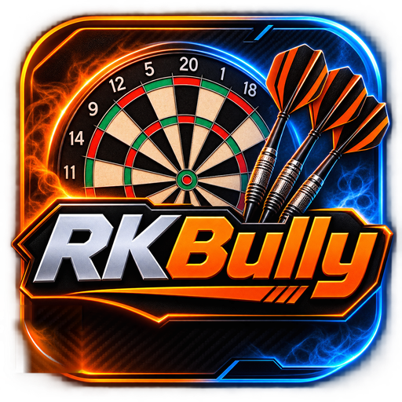
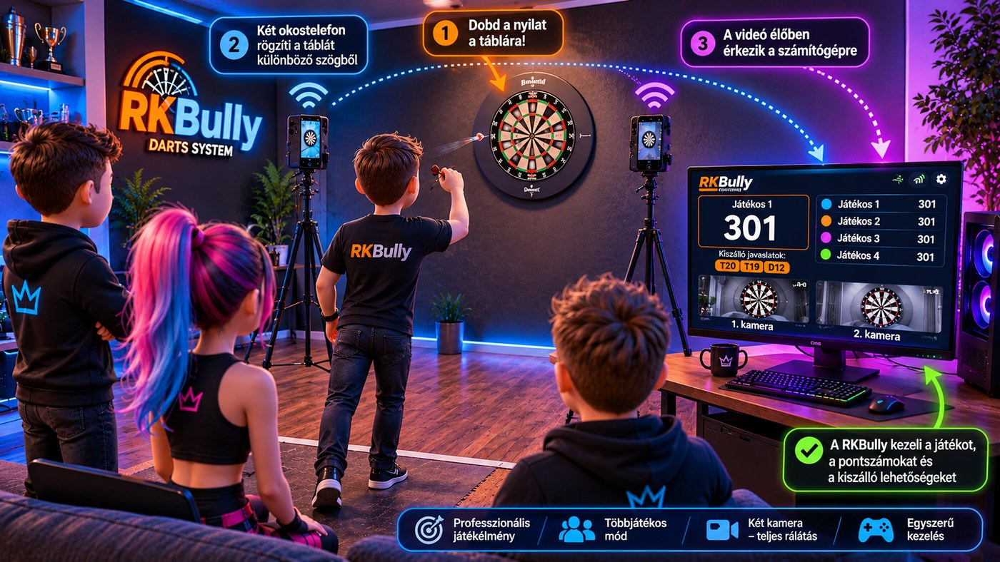
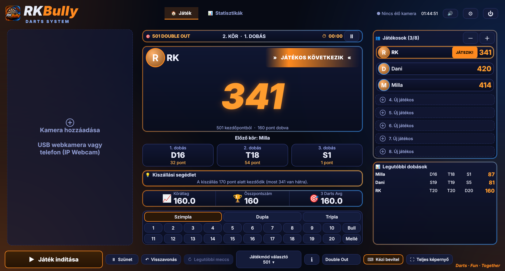
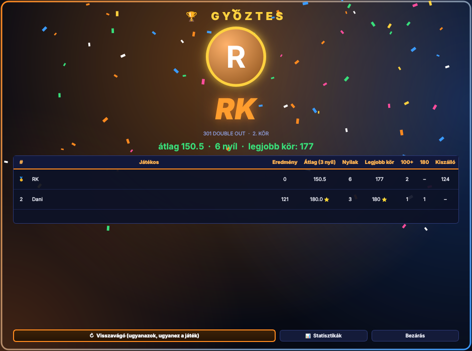
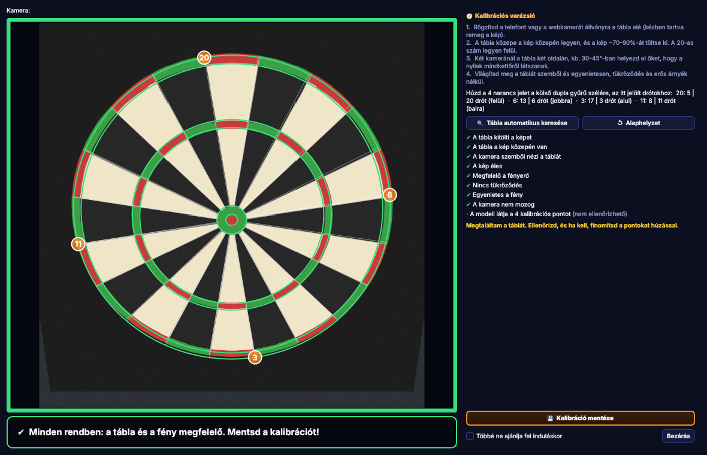
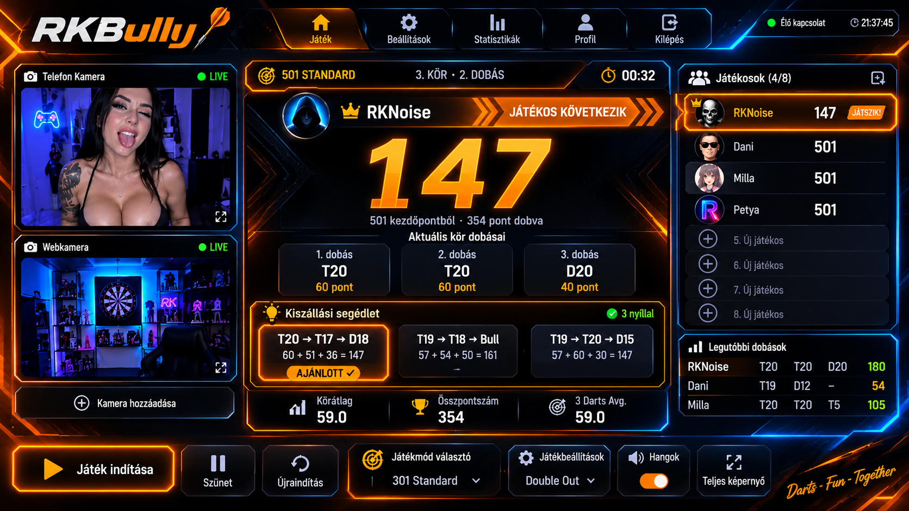
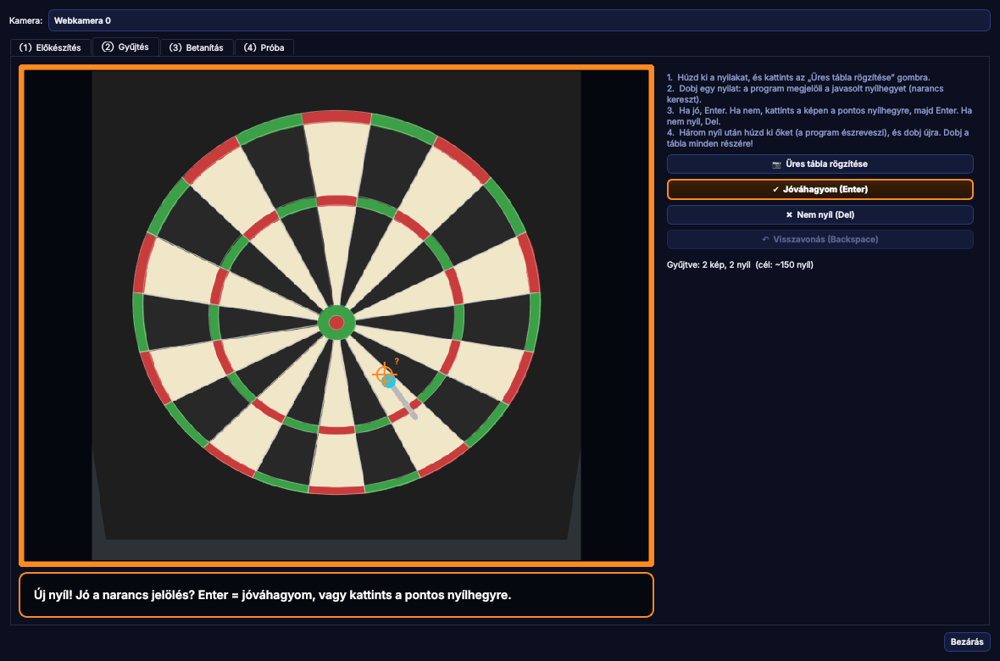

<div align="center">



# RKBully Darts System 1.0

**Futurisztikus, többjátékos darts-rendszer: élő kameraképpel, kamerás dobásfelismeréssel, 20 játékmóddal, hangokkal és pontszám-felolvasással.**

*Készítette: **RKNOISE***  ·  Windows 10/11  ·  Python 3.10–3.13  ·  PySide6

[Adatlap](#adatlap) · [Rendszerkövetelmények](#rendszerkövetelmények) · [Bemutató](#bemutató) · [Telepítés](#telepítés) · [Első indítás: kalibráció](#első-indítás-a-kalibrációs-varázsló) · [Játékmódok](#játékmódok) · [Hibaelhárítás](#hibaelhárítás) · [Fejlesztői adatlap](docs/FEJLESZTOI_ADATLAP.md)



<sub>Koncepcióábra a rendszer működéséről (illusztráció, nem a program képernyőképe).</sub>

</div>

## Adatlap

| | |
|---|---|
| **Név / verzió** | RKBully Darts System **1.0** |
| **Szerző** | RKNOISE |
| **Platform** | Windows 10/11 (a kód más rendszeren is fut, de a telepítő és a parancsikonok Windowsra készültek) |
| **Nyelv / keretrendszer** | Python 3.10–3.13, PySide6 (Qt), OpenCV, NumPy; a dobásfelismeréshez ultralytics (YOLO) |
| **Játékosok** | 1–8 fő, saját profillal (név, profilkép, szín, tartós statisztika) |
| **Játékmódok** | 301 / 501 / 701 (Double vagy Straight Out), Cricket, High Score, 6 party játék, 9 gyakorló mód |
| **Kamerák** | legfeljebb 3: USB webkamera és/vagy telefon (IP Webcam alkalmazás); két kamera képét a program összeveti |
| **Dobásfelismerés** | YOLO-modell (nyílhegy + 4 kalibrációs pont) és homográfia a tábla síkjába; a kört a játékos jóváhagyja |
| **Kalibráció** | Kalibrációs varázsló élő képpel: zöld/sárga/piros jelzés a tábla és a fények beállításához, automatikus táblakeresés |
| **Hang** | hangeffekt nyílra, duplára, triplára, bullra, következő játékosra, 100+ és 180 körre, bustra, győzelemre; a pontszám felolvasása a kör végén |
| **Meccs vége** | látványos győztes-képernyő konfettivel, átlagokkal és kiemelésekkel, visszavágó egy kattintással |
| **Kényelem** | kör-szünet (P / Pause), „Legutóbbi meccs újraindítása” gomb, visszavonás, kézi bevitel, teljes képernyő |
| **Adatok helye** | `%USERPROFILE%\.rkbully\` (beállítások, profilok, előzmények, kalibráció) |
| **Telepítés** | dupla kattintás: **teljes (offline) telepítő** – internet nélkül, minden függőséggel – vagy a kis online telepítő (lásd [Telepítés](#telepítés)) |
| **Fejlesztőknek** | a telepített mappa a futó forráskód + tesztek + dokumentáció: [`docs/FEJLESZTOI_ADATLAP.md`](docs/FEJLESZTOI_ADATLAP.md), [`docs/KODTERKEP.md`](docs/KODTERKEP.md) |
| **Licenc / modell** | a program AGPL-3.0 ([`LICENSE`](LICENSE), [`docs/LICENCEK.md`](docs/LICENCEK.md)); darts-modellt nem tartalmaz (lásd [Modell és licenc](#modell-és-licenc-fontos)), a sajátodat betaníthatod |

### Rendszerkövetelmények

A **minimum** a program kézi használatára és egy kamera felismerésére elég, az **ajánlott** a két kamerás, folyamatos
dobásfelismeréshez. *(Becsült értékek a program felépítése alapján: valódi gépeken mért teljesítményadatom még nincs.)*

| | **Minimum** | **Ajánlott** |
|---|---|---|
| **Asztali PC** | Windows 10 (64 bit); 4 magos processzor (pl. Intel Core i3/i5 8. gen., AMD Ryzen 3); 8 GB RAM; kb. 3 GB szabad hely (a PyTorch miatt); 1366×768 kijelző; USB-port vagy Wi-Fi/LAN | Windows 11 (64 bit); 6+ magos processzor (pl. Core i5/i7 10. gen.+, Ryzen 5/7); 16 GB RAM; SSD; 1920×1080 kijelző; vezetékes LAN vagy 5 GHz Wi-Fi |
| **Laptop** | ugyanaz, mint a PC-nél; 4 magos (U-sorozatú) processzor, 8 GB RAM, integrált videókártya elég; a felismerés alatt **töltőn** legyen (akkumulátor-takarékos módban lelassul) | 6+ magos (H-sorozatú vagy újabb U-sorozatú) processzor, 16 GB RAM, jó hűtés; töltőn, „teljes teljesítmény” energiaprofillal |
| **Telefon (kamera)** | Android 8 vagy újabb; **IP Webcam** alkalmazás (Play Áruház); 720p-s hátsó kamera; ugyanaz a Wi-Fi hálózat, mint a gépé; állvány vagy tartó | modern Android telefon 1080p-s, élesítést tartó hátsó kamerával; **5 GHz Wi-Fi**; töltő a telefonhoz (a folyamatos videó sokat fogyaszt); egy telefon egy kamera |
| **Webkamera (opcionális)** | USB webkamera, 720p, fix fókusz is jó | USB webkamera 1080p, kézi/rögzíthető fókusszal, állványra szerelhető |
| **Hálózat** | internet a telepítéshez; játék közben csak a helyi hálózat kell (a telefon és a gép egy hálózaton) | |
| **Szoftver** | Python 3.10–3.13 (a telepítő megkeresi, vagy feltelepíti), PySide6, OpenCV, NumPy; felismeréshez ultralytics + PyTorch | |

- **Felismerés nélkül** (kézi bevitellel) a program jóval kisebb gépen is elfut: lényegében csak a Python, a PySide6 és kb. 500 MB hely kell.
- **Videókártya nem kötelező.** A telepítő a PyTorch alap (processzoros) változatát teszi fel; NVIDIA-kártyás gyorsításhoz külön CUDA-s PyTorch kell.
- **iPhone / más alkalmazás:** az *IP Webcam* csak Androidra van. Bármilyen alkalmazás használható, ami HTTP (MJPEG) videófolyamot ad: a teljes címet (`http://...`) kell beírni a kamera hozzáadásakor. Ezt iPhone-nal **nem próbáltam ki**.
- **Két kamera** kétszer akkora terhelés a felismerésnek: gyengébb gépen kapcsold be a felismerést csak az egyiken, vagy használj erősebb gépet.

## Bemutató

A RKBully Darts System a megszokott darts-felületet kamerával és automatikus pontozással egészíti ki. Kézzel is
használható (a Szimpla/Dupla/Tripla és a számgombokkal), de a lényege az, hogy **két okostelefon vagy webkamera látja a
táblát**, a program felismeri a nyilakat, kiszámolja a pontokat, és csak akkor kér tőled valamit, ha bizonytalan.

**Hogyan megy egy kör?**

1. **Dobsz** a táblára.
2. **A kamerák** (állványra rögzített telefonok vagy webkamerák, a tábla két oldalán) élőben küldik a képet a gépre.
3. **A program** felismeri a nyílhegyeket és a tábla négy kalibrációs pontját, a nyilak helyét a tábla síkjára vetíti, és
   kiszámolja a mezőt. A 3. nyíl után **jóváhagyási idő** indul; ha minden egyértelmű, a kör magától elfogadódik, ha valami
   bizonytalan, megjelölve vár a jóváhagyásodra (koppintással javítható).
4. **Hang és felolvasás:** a program bemondja a kör pontszámát, a dupla, tripla és bull külön effektet kap.
5. **Meccs végén** látványos képernyő mutatja a győztest és mindenki átlagát; a *Visszavágó* gombbal ugyanazokkal indulhat
   a következő meccs.

<table>
<tr>
<td width="50%"><br><sub><b>Főablak:</b> kamerák balra, a soron lévő játékos középen (pontszám, kör dobásai, kiszálló-segédlet, átlagok), játékosok és legutóbbi dobások jobbra, vezérlősáv alul.</sub></td>
<td width="50%"><br><sub><b>Meccs vége:</b> a győztes kiemelve, konfettivel; az átlagok, a legjobb kör, a 100+ és 180-as körök és a kiszálló táblázata.</sub></td>
</tr>
<tr>
<td colspan="2"><br><sub><b>Kalibrációs varázsló:</b> élő kép zöld/sárga/piros kerettel, pipás ellenőrzőlistával és teendőkkel. (A képernyőkép szemléltető, generált tesztképet mutat, nem valódi tábla felvételét.)</sub></td>
</tr>
</table>

<div align="center">



<sub><b>Dizájnterv:</b> a felület kinézetének eredeti terve (koncepció, nem a program képernyőképe). A működő felület ehhez
igazodik, de több részletben eltér tőle.</sub>

</div>

### Főbb funkciók

- **20 játékmód** csoportokban (Klasszikus, Party, Gyakorló), mindegyikhez ℹ szabályleírással és játékosszám-ellenőrzéssel.
- **Kamerás dobásfelismerés** egy vagy két kamerával, jóváhagyással és bizonytalanság-jelzéssel.
- **Saját modell betanítása** a saját kameráid képeiből, a programon belül (gyűjtés → betanítás → próba).
- **Kalibrációs varázsló** élő képpel: fókusz, fényerő, tükröződés, egyenletesség, látószög, a kép nyugodtsága és a
  modell által látott kalibrációs pontok ellenőrzése; a tábla automatikus megkeresése.
- **Hangok és felolvasás:** effektek dupla/tripla/bull dobásra, a kör pontszámának bemondása magyarul.
- **Látványos meccs végi képernyő** a győztessel és az átlagokkal; **Visszavágó** gomb.
- **Legutóbbi meccs újraindítása** gomb: megjegyzi a játékosokat, a játékmódot és a kiszállást, akár újraindítás után is.
- **Kör-szünet:** a **⏸ Szünet** gombbal (vagy a **P** / **Pause** billentyűvel) az óra megáll, és újra folytatható.
- **Profilok és tartós statisztika:** átlag, 100+/180-as körök, legjobb kiszálló, győzelmek, előzmények.
- **Képernyőhöz igazodó felület**, teljes képernyős mód, kézi bevitel tartaléknak.

## Telepítés

### Egy kattintásos telepítő (ajánlott)

Két változat van, a kiadások (**Releases**) között:

| | Teljes (offline) telepítő | Online telepítő |
|---|---|---|
| Fájl | `RKBully_Darts_System_1.0_Teljes_Telepito.zip` (~410 MB) → kicsomagolás után `Telepites.bat` | `RKBully_Darts_System_1.0_Telepito_online.bat` (~12 MB) |
| Internet | **nem kell** – a Python 3.12 és az összes csomag benne van | kell (a PyTorch miatt kb. fél–egy GB letöltés) |
| Mikor | másik gépre, gyenge vagy nincs net, reprodukálható telepítés | ha van gyors net |

Az offline csomagban a `Telepites.bat` és az `offline` mappa egymás mellett legyen.

> **Amíg a telepítés fut (néhány perc), már helyezd el a telefonokat / webkamerákat a megfelelő helyre a kalibráláshoz.**
> A kalibráció a telepítés után egyből indul, amint megnyitod a programot.

1. Töltsd le a telepítőt a **Releases** oldalról (offline: a zip-et kicsomagolva a `Telepites.bat`; online: a `…_Telepito_online.bat`).
2. Kattints rá duplán. A Windows SmartScreen figyelmeztethet („A Windows megvédte a számítógépet”): válaszd a
   **További információ → Futtatás mindenképp** lehetőséget. (A telepítő egyszerű, olvasható szövegfájl: Jegyzettömbben
   megnyitva látszik a telepítő parancsfájl, utána a base64-ben kódolt programfájlok.)
3. A telepítő magától elvégez mindent:
   - kicsomagolja a programot ide: `%LOCALAPPDATA%\RKBully Darts System`;
   - megkeresi a **Python 3.10–3.13**-at, és ha nincs, telepíti (offline: a csomagbeli 3.12.8; online: winget, vagy 3.12 a python.org-ról; **rendszergazdai jog nélkül**);
   - létrehoz egy **saját, elkülönített Python-környezetet** (`venv`), és telepíti a csomagokat (PySide6, OpenCV, NumPy);
   - telepíti a **dobásfelismerés csomagját** (ultralytics + PyTorch: nagy, pár percig tarthat; ha nem sikerül, a program
     felismerés nélkül is működik);
   - parancsikont tesz az **Asztalra** és a **Start menübe**, és elindítja a programot.
4. **Közben**: rögzítsd a telefonokat/webkamerákat állványra a tábla elé (lásd [A kamerák elhelyezése](#a-kamerák-elhelyezése)), és
   telefon esetén indítsd el az *IP Webcam* alkalmazást.
5. Az **első indításkor** a bemutató kép után **automatikusan megnyílik a Kalibrációs varázsló**.

Szükséges: Windows 10/11 (64 bit), kb. 3 GB szabad hely; az online változatnál internet is.
A telepítés végén a telepítési mappában megtalálod a `TELEPITES_INFO.txt`-t (verzió, mód, pontos csomagverziók) és a `telepites.log`-ot.

**Frissítés:** futtasd újra az új telepítőt: felülírja a program fájljait, de a beállításokat, profilokat és a `models` mappát nem bántja.
**Eltávolítás:** Start menü → *RKBully Darts System* → *Eltavolitas*, vagy a telepítési mappában az `Eltavolitas.bat`.
A telepítés naplója a telepítési mappában a `telepites.log`.

### Kézi telepítés (fejlesztőknek)

```bat
git clone https://github.com/rknoise/rkbully-darts-system
cd rkbully-darts-system
python -m pip install -r requirements.txt
python -m pip install -r requirements-felismeres.txt   :: a dobásfelismeréshez
python rkbully.py
```

A repóban lévő `RKBully_indit.bat` ugyanezt végzi, a `Parancsikon_letrehozasa.bat` pedig parancsikont készít az Asztalra.
A telepítőket magad is összeállíthatod: `python tools/build_installer.py` (online), `python tools/build_offline.py` majd `python tools/build_installer.py --offline dist/offline` (teljes offline csomag). A részleteket lásd a [Fejlesztői adatlapban](docs/FEJLESZTOI_ADATLAP.md).

### A kamerák elhelyezése

1. **Állvány:** rögzítsd a telefont vagy a webkamerát állványra a tábla előtt (kézben tartva remeg a kép, és a kalibráció elcsúszik).
2. **Kép:** a tábla közepe a kép közepén legyen, a tábla a kép szélességének kb. 70–90%-át töltse ki, a **20-as szám felül**.
3. **Két kamera:** a tábla két oldalán, kb. 30–45°-os szögben, hogy a nyilakat mindkettő lássa (így egy nyilat nem takar ki a dobó keze).
4. **Fény:** világítsd meg a táblát szemből és egyenletesen; kerüld a tükröződést (ne villantson lámpa a tábla felületén) és az erős oldalárnyékot.
5. **Telefon:** a telefon és a gép legyen ugyanazon a Wi-Fi hálózaton; *IP Webcam* (Android) → *Start server* → jegyezd fel a kijelzőn látható címet (pl. `192.168.0.56:8080`).
6. **USB webkamera:** csak a sorszámát kell megadni (`0`, `1`, ...).

## Első indítás: a Kalibrációs varázsló

Amikor az első indításkor megnyílik, a varázsló végigvezet a beállításon (később bármikor: **⚙ Beállítások → Kamera → Kalibrációs varázsló**):

1. **Kamera hozzáadása:** ha még nincs kamera, a varázsló elmagyarázza az elhelyezést, és a **⊕ Kamera hozzáadása** gombbal (USB szám vagy telefon cím) azonnal felveheted.
2. **Élő kép és jelzés:** a kép körül **zöld** (minden rendben), **sárga** (használható, de javítható) vagy **piros** (javítandó) keret mutatja az állapotot, alatta egy mondat, hogy mit tegyél.
3. **Ellenőrzőlista (pipák):** a tábla kitölti-e a képet, középen van-e, szemből nézi-e a kamera, éles-e a kép, megfelelő-e a fényerő, nincs-e tükröződés, egyenletes-e a fény, nem mozog-e a kamera, és (ha van modell) **látja-e a modell a 4 kalibrációs pontot**.
4. **Tábla megkeresése:** a **🔍 Tábla automatikus keresése** gomb megkeresi a táblát; a 4 narancs jelet (20 | 6 | 3 | 11 drótok a külső dupla gyűrűn) ráhúzással finomíthatod.
5. **💾 Kalibráció mentése:** kamerankénti mentés. A **Többé ne ajánlja fel induláskor** jelölővel a varázsló nem nyílik meg magától.

> A varázsló határértékei (élesség, fényerő stb.) tapasztalati értékek, szintetikus képeken hangoltam őket. Valódi kamerával
> az első használatkor előfordulhat, hogy egy jelzés túl szigorú vagy túl engedékeny: ilyenkor a lista szövege akkor is tájékoztat, és a mentést nem akadályozza.

## A felület

Neon HUD kinézet: bal oldalt a kamerák, középen a soron lévő játékos (nagy pontszámmal, a kör dobásaival, kiszállási
segédlettel és átlagokkal), jobb oldalt a játékosok és a legutóbbi dobások, alul a vezérlősáv (Játék indítása, Szünet,
Visszavonás, Legutóbbi meccs, Játékmód választó + ℹ, Double/Straight Out, Kézi bevitel, Teljes képernyő).

- **Képernyőhöz igazodás:** a betűk és méretek az ablak méretéhez skálázódnak, és a program méréssel ellenőrzi, hogy a
  tartalom belefér-e. Ha kis a képernyő, először kicsit kisebbre skáláz, aztán elrejti a segédletet és az átlagsávot,
  majd összecsukja a kézi bevitelt (a **⌨ Kézi bevitel** gomb ilyenkor is megnyitja). A program a képernyő 94%-ánál
  nagyobb ablakkal sosem indul, és maximalizálva nyílik meg (ez a ⚙ Megjelenés oldalon kikapcsolható).
- **⚙ Beállítások (fogaskerék, jobb felül):** *Profilok*, *Játék* (kamerás kör jóváhagyása, ellenőrzési idő, meccs végi képernyő),
  *Kamera* (modellfájl, **Kalibrációs varázsló**), *Hang*, *Megjelenés*, *Névjegy* (verzió, a program készítője: **RKNOISE**).
- **⏸ Szünet:** megállítja a kör-időmérőt és a kamerás jóváhagyás visszaszámlálását, és letiltja a bevitelt. A fejlécben a
  kör-óra helyén „⏸ SZÜNET” látszik a megállított idővel; újra a gombbal, vagy a **P** / **Pause** billentyűvel folytatható,
  és a szünet idejét az óra nem számolja. (Egy játékmód újraindítása is oldja a szünetet.)
- **↻ Legutóbbi meccs:** a gomb megjegyzi az utolsó (megkezdett vagy befejezett) meccs **játékosait, játékmódját és a
  kiszállást**, és egy kattintással újraindítja őket. Az adat elmentődik, így a program újraindítása után is működik.
  Szűk ablakban a gomb elrejtőzik.
- **🏆 Meccs végi képernyő:** a győztes nevével, profilképével és konfettivel; táblázat az eredményről, a 3 nyilas átlagról, a
  nyilak számáról, a legjobb körről (⭐ a legjobb átlag és a legjobb kör), a 100+ és 180-as körökről és a kiszállóról.
  Gombok: **Visszavágó** (ugyanazok, ugyanez a játék), **Statisztikák**, **Bezárás**. A ⚙ Játék oldalon kikapcsolható.
- **🔊 Hangok:** a dobások után hangeffekt szól: nyíl a táblán, **dupla**, **tripla**, **bull**, következő játékos, 100+ kör,
  180, bust és győzelem. A hang a játék állapotából jön, így kézi bevitelnél és kamerás felismerésnél is ugyanúgy szól; a
  visszavonás és az új játék néma. A fejléc **🔊** gombja egy kattintással némít; a ⚙ Hang oldalon hangerő, próbagombok és
  a **felolvasás** kapcsolója van. Az effektek az `assets/sounds` mappában lévő kis WAV fájlok (a `tools/make_sounds.py`
  szintetizálja őket); bármelyik felülírható saját fájllal.
- **🗣 Pontszám-felolvasás:** a kör végén (és győzelemkor) a program bemondja a kör pontszámát és az állást magyarul
  („száznyolcvan!”). A felolvasás a gép hangját használja: Windowson magyar hang esetén magyarul, különben számjegyekkel. Ha
  nincs hangmotor, a program csendben megy tovább.
- **Üdvözlő ablak:** induláskor a bemutató kép (`assets/welcome.jpg`) jelenik meg. Bezárható a **Bezárás** gombbal, az ✕-szel
  vagy az Esc-vel; a **Többé ne jelenjen meg** jelölővel nem nyílik meg újra (a ⚙ Megjelenés oldalon visszakapcsolható).
- **Profilok:** a Beállítások → Profilok oldalon szerkeszthető minden játékos: **név**, **profilkép** (JPG/PNG/BMP/WebP; a
  program 256×256-os, négyzetre vágott kis JPG-vé alakítja) és **szín**. Átnevezéskor a futó játékban és az
  előzményekben is megváltozik a név. A játékoslista melletti **＋** gombbal profilból adhatsz hozzá játékost, a **－**
  gombbal kiveszed az utolsót (a profil megmarad). Ugyanitt látod a profil **statisztikáját**, és a **↺ Statisztika nullázása**
  gombbal (megerősítés után) lenullázhatod; ez csak az adott profilt érinti, a befejezett játékok listája megmarad.
- **Statisztikák (tartós):** minden befejezett játék automatikusan mentődik a `%USERPROFILE%\.rkbully\history.json`
  fájlba (legfeljebb az utolsó 1000). A fejléc *Statisztikák* gombja három oldalt nyit:
  - **Összesítés:** profilonként a játékok és győzelmek száma, győzelem %, 3 nyilas átlag, legjobb kör, 100+ és 180-as
    körök, legjobb kiszálló. Játékmód szerint szűrhető. A győzelem % csak a legalább két játékos által játszott
    játékokból jön, az átlag és a körök csak a 301/501/701-ből, a bust kör nem ér pontot.
  - **Folyó játék:** az éppen játszott játék adatai (körök, nyilak, dobott pont, legjobb kör, átlag).
  - **Előzmények:** a legutóbbi játékok, legfrissebb elöl (👑 győztes, 🤝 döntetlen), és az **Előzmények törlése** gomb.

## Játékmódok

A játékmódot az alsó sávban a **🎮 játékmód gombbal** választod: a megnyíló ablakban csoportonként (Klasszikus, Party,
Gyakorló) kártyák vannak, mindegyiken a játékosszámmal.

| Csoport | Játékok | Játékosok |
|---|---|---|
| Klasszikus | 301, 501, 701 (Double Out / Straight Out, bust-kezelés, kiszálló-javaslat), Cricket, High Score | 1–8 (Cricket: 2–8) |
| Party | Around the Clock, Shanghai, Killer, Baseball, Golf, Bermuda Triangle | 1–8 (Killer: 2–8) |
| Gyakorló | Bob's 27, 121–170 Checkout, Catch 40, Duplák, Bull, A1 gyakorló, 100 nyíl, Scoring 99, Scoring 121 | 1–8 |

**ℹ Szabályok:** minden játékmódnál van ℹ gomb (a választó ablakban a kártyán, játék közben az alsó sávban). A megnyíló
ablak megmondja, **hányan játszhatják**, és lépésről lépésre leírja, **hogyan kell játszani**. Ha egy játékhoz több játékos
kell (pl. Killer: legalább 2), a program szól, és nem enged kevesebbel indítani. A játékok pontos szabályai és forrásai,
valamint hogy hol választottam több elterjedt változat közül: [`docs/jatekmodok.md`](docs/jatekmodok.md).

## Kamerák

A bal oldali **Kamera hozzáadása** gombbal, legfeljebb 3 kamera:

- **USB webkamera:** írd be a sorszámát (`0`, `1`, ...).
- **Telefon:** telepítsd az *IP Webcam* alkalmazást (Android), nyomd meg a *Start server* gombot, és írd be a kijelzőn
  látható címet, például `192.168.0.56:8080`. A telefon és a gép legyen ugyanazon a Wi-Fi hálózaton.

## Kamerás dobásfelismerés (kísérleti)

Egy kamera képén megkeresi a nyílhegyeket és a tábla négy-hat kalibrációs pontját, ebből kiszámolja, melyik mezőbe
ment a nyíl. A kalibrációs pontokat a program zöld körrel, a nyilakat piros körrel rajzolja a képre, így azonnal
látod, jól áll-e a kamera.

### Beüzemelés

1. A telepítő az ultralytics csomagot is feltelepíti. Ha az nem sikerült, vagy kézzel telepítesz: kattints duplán a
   **`Felismeres_telepitese.bat`** fájlra (vagy: `python -m pip install ultralytics`). Nagy csomag, a PyTorch-ot is hozza,
   pár percig tarthat.
2. Modellfájl: egy DeepDarts / Dart-Sense típusú YOLO `.pt` fájl (osztályok: `dart` és kalibrációs pontok `20`, `3`,
   `11`, `6`, opcionálisan `9`, `15`). Tedd a `models` mappába (a telepítési mappában), vagy a program az első bekapcsoláskor megkérdezi.
3. Állítsd be a kamerát a **Kalibrációs varázslóval** (lásd fent): a tábla töltse ki a kép **közepét**, szemből vagy enyhe
   szögből nézzen rá, a kép legyen éles és egyenletesen megvilágított, és a kamera **ne mozogjon**.
4. Kamera-kártyán: **Dobásfelismerés** gomb. Amíg a státusz azt írja, hogy *Kalibrálva*, jó a beállítás.

Beállítás ellenőrzése egy-egy fényképen: `python check_model.py models\modell.pt kep.jpg`

### Hogyan működik a kör jóváhagyása

A felismert dobások nem kerülnek azonnal a pontok közé.

- Ahogy a nyilak leszállnak, megjelennek a kék jóváhagyó panelen.
- Amikor megvan a **3. nyíl**, elindul a **60 másodperces visszaszámlálás**, a program kiírja, mennyit érzékelt
  (pl. `T20 + S5 + D16 = 97`).
- Ha valamelyik nem stimmel: **koppints arra a nyílra**, és üsd be a helyes mezőt (Szimpla / Dupla / Tripla + szám).
  A javított nyílnál látszik, mi volt az eredeti. Javítás közben nem járhat le az idő (legalább 20 mp marad).
- A **sárga szaggatott** keretű nyíl bizonytalan (szektordrót vagy gyűrűhatár mellett van, vagy a kalibráció
  pontatlan). Amíg ilyen van, a program **nem fogadja el magától** a kört, a jóváhagyásodra vár.
- Ha minden nyíl biztos, a visszaszámlálás végén automatikusan elfogadja. Az **Enter** vagy a *Jóváhagyom* gomb
  azonnal elfogadja. A lenti legördülő menüben beállítható a *mindig kézi jóváhagyás* is.
- Ha a tábla mellé ment egy nyíl, azt a kamera nem látja: üsd be kézzel (*Mellé*). Ha 3-nál kevesebb nyilat látott,
  és kihúzták őket, a hiányzókat mellének veszi, de jóváhagyást kér.
- Ha bust vagy kiszálló miatt a kör idő előtt véget ér, a megmaradt dobások nem kerülnek a következő játékoshoz.

### Két kamera együtt (kísérleti)

Kapcsold be a **Dobásfelismerés** gombot mindkét kamera kártyáján. Minden kamera önállóan kalibrál a tábla négy
jelöléséből (20, 3, 11, 6), így a kamerák között **nincs külön kalibráció**: mindkettő ugyanabba a koordináta-rendszerbe
(a tábla síkja, mm) vetíti a nyílhegyet, és a program ezeket veti össze. Érdemes két különböző irányból nézni a táblát,
hogy egy nyíl vagy a dobó keze ne takarja ki mindkét kamerának ugyanazt.

| Jelzés a jóváhagyó panelen | Mit jelent |
|---|---|
| `2 kamera egyezik` | mindkét kamera ugyanabba a mezőbe, 8 mm-en belül teszi a nyilat: a program a két becslés súlyozott átlagával számol |
| `ellenőrizd: kamerák eltérnek` | a két kamera más mezőt lát, vagy 8 mm-nél jobban eltérnek: a megbízhatóbb kamera helyét veszi, de a jóváhagyásodra vár |
| `ellenőrizd: csak 1 kamera látta` | a másik, jól működő kamera 2,5 másodperc alatt sem erősítette meg (takarás vagy téves találat) |
| `ellenőrizd: határ közelében` | a nyíl a drót mellett van (3 mm-en belül), két kamerával is |

- Ha a másik kamera éppen nem használható (nincs képe, vagy nincs kalibrálva), az egyik kamera dobása azonnal számít,
  pontosan úgy, mint egy kamerával.
- A nyilak kihúzását akkor veszi észre, ha minden kamera jelezte (legfeljebb 3 másodperc várakozással).
- Három kamerával az első kettő egyező észlelés dönt, a harmadik csak megerősít.
- A küszöbök (14 mm párosítás, 8 mm eltérés, 2,5 mp várakozás) az én választásaim, a `FusionHub` paraméterei között (`fusion.py`) állíthatók;
  a súlyozás is heurisztika (a magabiztosabb és jobban kalibrált kamera többet számít), mért adatból nem vezettem le.
  A tesztek szimulált kamerákkal futnak (két különböző nézőpont, zajjal), valódi telefonos felvétellel még nem.

### Pontosság, korlátok

- A Dart-Sense szerzője a saját tesztjén 88,4%-os képenkénti pontosságot közöl (egy kép = akár 3 nyíl teljes
  összege); a DeepDarts cikke 94,7%-ot (frontális felvételek) és 84,0%-ot (nehezebb adatkészlet, többféle szög).
  Egy kamerával nem lehet 100%, ezért van a jóváhagyás. A hibák többsége a takarásban lévő nyíl, vagy a szektordrót
  melletti találat.
- A mellékelt mintaképeken (10 db, 23 nyíl) a saját láncunk 22 nyilat pontozott a kézi címkével azonosan, az
  eltérés bizonytalannak volt jelölve.
- Két kamera együtt is használható (lásd lent), de az ettől várt pontosságnövekedést valódi felvételeken még nem mértem.
- Egymáshoz 10 mm-nél közelebb szúrt két nyilat a program egynek veszi (a modell néha ugyanahhoz a nyílhoz két
  közeli találatot ad); ilyenkor javítsd kézzel.

### Modell és licenc: fontos

A program **nem tartalmaz modellfájlt**. A Dart-Sense modellje (`weights.pt`) a szerző szerint csak nem kereskedelmi,
személyes használatra van (a README *non-distributable*-t ír, a LICENSE.md CC BY-NC 4.0-t). Ezért:

- ne tedd fel a modellt GitHubra (a `.gitignore` kizárja a `models` mappát és a `.pt` fájlokat);
- ha publikálni akarod a RKBully Darts Systemet modellel együtt, kérj engedélyt a szerzőtől, vagy taníts saját modellt a DeepDarts
  nyílt adatkészletén (IEEE DataPort), YOLOv8n-nel.

A teljes (offline) telepítő a betanítás kiinduló súlyait (`yolov8n.pt`, Ultralytics, AGPL-3.0; nem darts-modell) tartalmazza, így a saját modell betanítása is internet nélkül megy.

A `.pt` fájl betöltése kódot futtathat, ezért csak megbízható forrásból származót használj.
A többi vizsgált projekt (OpenDartboard, DeepDarts, Scored, darts-o-mat, Autodarts) összehasonlítása:
`docs/nyilt-forras-projektek.md`.

## Saját modell betanítása a saját kamerádból

Nem kell külső modellfájl: a program a **te kameráid képeiből** tanít dobásfelismerő modellt. **⚙ Beállítások → Kamera →
🎓 Modell betanítása** nyitja meg az ablakot, négy lépésben:

<div align="center">

<br><sub>A gyűjtés lap: a program az új nyílhegyet narancs kereszttel javasolja (szintetikus tesztképpel készült képernyőkép).</sub>
</div>

1. **① Előkészítés:** a kamerához mentett kalibráció kell (Kalibrációs varázsló), és az ultralytics csomag a tanításhoz.
2. **② Gyűjtés:** húzd ki a nyilakat, kattints az *Üres tábla rögzítése* gombra, majd dobj. A program észreveszi az új nyilat
   (a képet az üres táblához hasonlítja), és megjelöli a javasolt nyílhegyet. **Enter** = jóváhagyom, a képre kattintva
   **kijavíthatod** a helyét, **Del** = nem nyíl (árnyék, kéz), **Backspace** = visszavonás. Ha két nyíl összeér, az adott körből
   nem készül tanítókép (a címke megbízhatatlan lenne). A gyűjtés bármikor megszakítható és folytatható: minden jóváhagyott
   kép azonnal lemezre kerül (`%USERPROFILE%\.rkbully\training`). A program jelzi, a tábla melyik részére dobj még.
3. **③ Betanítás:** válassz beállítást (Gyors / Normál / Alapos), a tanítás külön folyamatban fut haladásjelzővel és hátralévő
   idővel; közben a gép használható, és megszakítható. Legalább 30 képnél indítható, használható modellhez kb. 150 nyíl kell.
   Videokártya nélkül (alapértelmezett telepítés) a tanítás processzoron fut, ami lassabb.
4. **④ Próba:** a kész modell megméri magát a gyűjtött képeken (a tanításban nem használt, körönként elkülönített képeken, ha
   van elég kör): hány nyilat talált meg, hány kalibrációs pontot látott, és mekkora a hiba mm-ben. Ha jó, a **Modell használatba
   vétele** gombbal a `models` mappába másolódik, és a Dobásfelismerés legközelebb azt tölti be.

> A betanító háttere (nyílkeresés, adatkészlet, tanítás, mérés) szintetikus adatokkal tesztelt, a teljes betanítás egy kis
> mintán végig is futott. Valódi kamerával a javaslatok pontossága még nincs kipróbálva: ezért jóváhagyás az alapja.

## Hibaelhárítás

| Tünet | Megoldás |
|---|---|
| A telepítő SmartScreen-figyelmeztetést ad | *További információ → Futtatás mindenképp*. A telepítő olvasható szövegfájl, megnézheted. |
| „Nem sikerült telepíteni a csomagokat” | Ellenőrizd az internetet, és futtasd újra a telepítőt (a már letöltött részeket nem kezdi elölről). A napló: `telepites.log` a telepítési mappában. |
| A dobásfelismerés gomb nem működik / „ultralytics hiányzik” | Futtasd újra a telepítőt, vagy a `Felismeres_telepitese.bat`-ot. A Python 3.10–3.13 ajánlott (a telepítő ilyet keres, és ha nincs, telepít). |
| „Nincs élő kamera” | USB: próbáld a `0`, `1`, `2` sorszámot. Telefon: ugyanaz a Wi-Fi, fut-e az *IP Webcam* szerver, a cím egyezik-e a kijelzőn láthatóval. |
| A varázsló pirosat jelez | Olvasd el a lista alatti teendőt (fókusz, fény, tükröződés, kamera helye); a jelzés élőben frissül. |
| Nincs hang / nem olvassa fel a pontot | ⚙ Beállítások → Hang: hangerő, effektek és felolvasás kapcsolója; a **Kipróbálás** gombok. A felolvasáshoz a Windowsnak kell hangmotor (magyar hang a legjobb). |
| Kis képernyőn kilóg valami | A program méretezi magát; a *Teljes képernyő* gombbal vagy a ⚙ Megjelenés oldalon állítható. |

## Tesztek

`python -m unittest discover -s tests -t .` (**490 teszt**, képernyő és kamera nélkül futnak): tábla-geometria, minden játékmód
szabályai és véletlen dobásos próbák, dobáskövetés, jóváhagyás és szünet, kiszálló útvonalak, statisztika és előzmény, profilok,
felület (beállítások, ablakillesztés kis képernyőn, meccs vége, legutóbbi meccs, szünet), hangok és felolvasás, két kamera
összevetése, kalibrációs varázsló és kamera-ellenőrzés (szintetikus képekkel), a betanító háttere és ablaka, ikonfájlok és parancsikon-scriptek.

## Fájlok

| Fájl | Tartalom |
|---|---|
| `rkbully.py` | főablak (neon HUD), játékmód-választó, kamerák, szünet, legutóbbi meccs, indítás |
| `appinfo.py` | a program neve, szerzője (RKNOISE), verziója |
| `theme.py` | színek, stíluslap (méretezhető), neon keretes kártya, kerek profilkép |
| `options.py` | ⚙ Beállítások ablak (profilok, játék, kamera, hang, megjelenés, névjegy) |
| `wizard.py` | Kalibrációs varázsló (élő kép, zöld/piros jelzés, húzható pontok, mentés) |
| `camcheck.py` | a kép- és fényellenőrzés mérőszámai és a tábla automatikus megkeresése |
| `finish.py` | meccs végi képernyő (győztes, átlagok, konfetti) |
| `sounds.py` / `speech.py` | hangeffektek; pontszám-felolvasás magyar számnevekkel |
| `ask.py` | Igen/Nem megerősítő kérdés magyar gombokkal |
| `welcome.py` | az induláskor megjelenő üdvözlő ablak |
| `profiles.py` / `stats.py` / `history.py` / `statsview.py` | profilok, statisztika, tartós előzmény, a Statisztikák ablak |
| `games.py` | játékmotor: minden játékmód szabálya, pontozása, leírása |
| `dartboard.py` | tábla geometriája, pontszámítás, kalibráció (homográfia) |
| `vision.py` / `fusion.py` / `review.py` | modell és dobáskövetés; két kamera összevetése; a kör jóváhagyása |
| `trainer_ui.py` | a Modell-betanító ablak (gyűjtés, betanítás, próba, használatba vétel) |
| `trainer.py`, `tools/train_worker.py` | a betanítás háttere: nyílkeresés képkülönbséggel, YOLO-adatkészlet, tanítás, mérés |
| `check_model.py` | modell és beállítás ellenőrzése egy fényképen |
| `installer/`, `tools/build_installer.py`, `tools/build_offline.py` | az online és a teljes (offline) telepítő forrása és összeállítói |
| `requirements*.txt` | kötelező csomagok, dobásfelismerés (ultralytics), és `requirements-lock.txt` = az 1.0-ban tesztelt pontos verziók |
| `LICENSE`, `docs/LICENCEK.md` | AGPL-3.0 és a harmadik felek csomagjainak licencei |
| `docs/FEJLESZTOI_ADATLAP.md`, `docs/KODTERKEP.md`, `docs/KIADAS_1.0.md` | fejlesztői adatlap (architektúra, adatformátumok, módosítás), a generált kódtérkép, kiadási jegyzék |
| `tools/make_codemap.py` | a `docs/KODTERKEP.md` újragenerálása a forrásból |
| `RKBully_indit.bat`, `Parancsikon_letrehozasa.bat`, `Felismeres_telepitese.bat` | kézi indítás / parancsikon / felismerés-csomag |
| `assets/` | logó, ikon, üdvözlő kép, hangeffektek |
| `docs/` | fejlesztői dokumentáció, játékmódok leírása, a vizsgált nyílt forrású projektek, a README képei |
| `tools/make_screenshots.py` | a README képernyőképeinek újragyártása (képernyő nélkül) |

## A logó cseréje

A logó az `assets/rkbully_forras.png` képből készül. Ha másikat szeretnél, írd felül ezt a fájlt (négyzet alakú,
átlátszó háttérrel a legjobb), futtasd a `python tools\make_icons.py` parancsot (előtte `pip install pillow`),
majd a `Parancsikon_letrehozasa.bat` fájlt, hogy az Asztali ikon is frissüljön.

## Mi nincs még kipróbálva (őszintén)

- **Valódi kamerával és táblával** a kalibrációs varázsló küszöbértékei és az automatikus táblakeresés még nem lettek
  kipróbálva; szintetikus képeken hangoltam őket (erősen ferde nézetnél a táblakeresés pontatlan: a pontok húzhatók).
- **A telepítőt** Windowson még nem futtattam; a kicsomagolást és a PowerShell-szintaxist ellenőriztem, a Python/venv/pip lépések
  és a parancsikonok élesben ellenőrzésre várnak. Ha valami elakad, a `telepites.log` megmutatja, hol.
- **A hangeffektek és a felolvasás** képernyő és hangkimenet nélküli gépen készültek (a tesztek a hangmotort szimulálják): a hangerő
  és a magyar kiejtés a te gépeden derül ki.
- **A saját modell betanítása:** a háttér és az ablak szintetikus képekkel tesztelt; valódi kamerával, táblával és nyilakkal még nem próbáltam (a javaslatok pontossága és a tanítás ideje a te gépeden derül ki).
- Windows-specifikus dolgok (tálca-ikon, betűtípusok, DPI-skálázás) élesben ellenőrzésre várnak.

## Köszönet és szerző

**A RKBully Darts System programot RKNOISE készítette.** A nyílt forrású darts-projektek (DeepDarts, Dart-Sense, OpenDartboard,
darts-o-mat, Autodarts, Scored) összehasonlítása: [`docs/nyilt-forras-projektek.md`](docs/nyilt-forras-projektek.md).

<sub>*Darts · Fun · Together*</sub>
